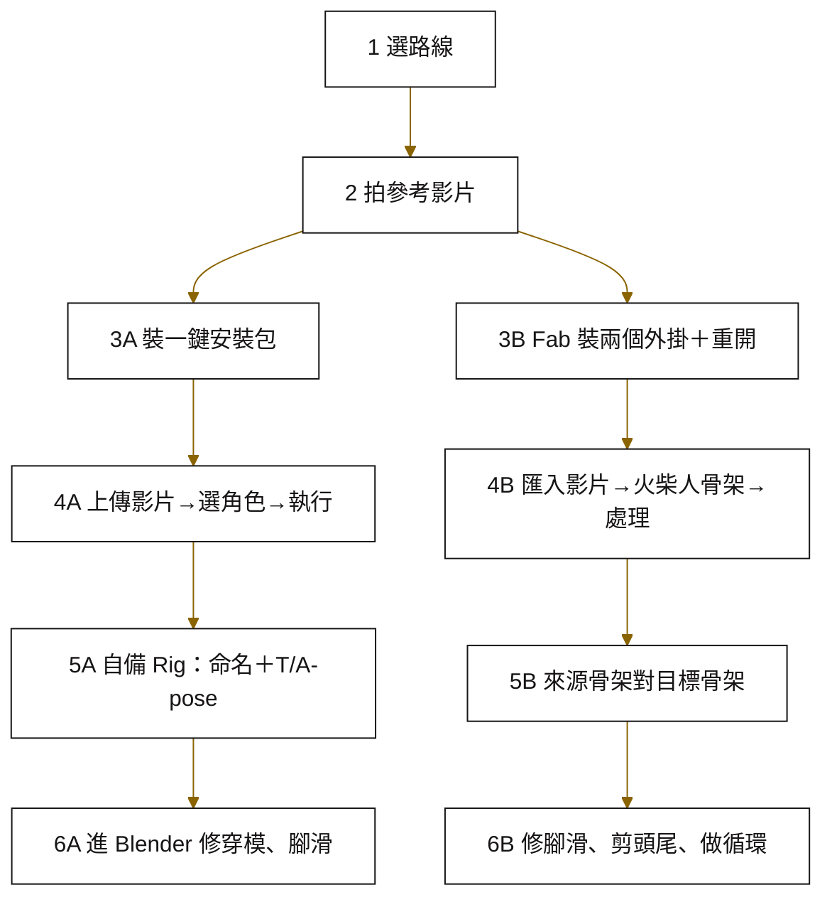

<picture>
  <source media="(prefers-color-scheme: dark)" srcset="assets/banner-dark.svg">
  
</picture>

<h1 align="center">🎬 手機影片變 3D 動作</h1>

<p align="center"><b>拍一段影片，抓出動作，套到你的 3D 角色上——不用動捕衣、不用攝影棚</b></p>

<p align="center">
  
  
  
</p>

<p align="center">
  <a href="#-這個技能能做什麼">能做什麼</a> •
  <a href="#-怎麼用">怎麼用</a> •
  <a href="#-這些書在講什麼">這些書在講什麼</a> •
  <a href="#-怎麼應用">怎麼應用</a> •
  <a href="#-常見問題">常見問題</a>
</p>

這是一個讓 Claude 帶你「用手機影片做 3D 角色動作」的技能。以前要讓角色動起來，得穿動捕衣、租攝影棚，或一格一格手 K；現在對著白牆演一遍，就能抓出一段有真人重心和停頓的動作。看完這篇，你會知道該走哪條路線、每一步做完應該看到什麼，以及哪裡還沒人驗證過。

## 📌 目錄

- [✨ 這個技能能做什麼](#-這個技能能做什麼)
- [🤔 為什麼做這個](#-為什麼做這個)
- [🚀 怎麼用](#-怎麼用)
- [🧭 流程總覽](#-流程總覽)
- [🛤️ 兩條路線怎麼選](#️-兩條路線怎麼選)
- [📚 這些書在講什麼](#-這些書在講什麼)
- [🧭 怎麼應用](#-怎麼應用)
- [📖 名詞對照](#-名詞對照)
- [❓ 常見問題](#-常見問題)
- [🧩 還缺什麼](#-還缺什麼)

## ✨ 這個技能能做什麼

Claude 讀了這個技能，會照六關帶你走完，每關都告訴你「做什麼、做完應該看到什麼、出錯怎麼辦」。

| | 能做的事 | 白話說 |
|---|---|---|
| 🧭 | 幫你選路線 | 角色是人還是動物、最後用在 Unreal 還是 Blender，決定走哪條 |
| 📱 | 教你拍參考影片 | 手機怎麼擺、怎麼站、怎麼打光，避免抓出來的骨架亂飄 |
| ⚙️ | 帶你裝工具 | 開源一鍵安裝包，或 Unreal 的兩個免費外掛 |
| 🦴 | 抓動作＋套到角色 | 從影片抓骨架，再 Retarget 到你自己的模型 |
| 🧹 | 提醒你清理 | 腳滑、頭尾停頓、循環接點，按完不等於能上線 |

> [!TIP]
> 這套做法是「AI 看懂你的動作並複製下來」，不是「AI 幫你想動作」。你演得越清楚，結果越好。

## 🤔 為什麼做這個

我們的案子常常卡在「角色有了，動作不夠」。NPC 要開門、搬箱子、按按鈕，吉祥物要揮手跳舞——外包或買動畫包都要錢、要等，手 K 又很難做出真人那種重心偏移和小晃動。

兩篇來源筆記剛好給了兩條互補的路：一條是開源工具＋Blender，什麼骨架都吃；一條是整個在 Unreal 裡做完，兩個外掛都免費。我們把它們整理成同一份 SOP，讓夥伴不用每次從頭看影片。

> [!WARNING]
> 來源筆記沒寫工具版本、硬體需求、影片規格和輸出格式。技能會老實告訴你「這裡筆記沒提供」，不會幫你猜。

## 🚀 怎麼用

### 1. 裝進 Claude Code

把整個資料夾放進你專案的技能目錄：

```bash
# 在你的專案根目錄
mkdir -p .claude/skills
cp -r ai-video-mocap .claude/skills/
```

裝好後的位置應該是 `.claude/skills/ai-video-mocap/SKILL.md`。

### 2. 叫它出來

在 Claude Code 裡直接講人話就會觸發，例如：

| 你可以這樣說 | Claude 會做什麼 |
|---|---|
| 「我想用手機拍影片幫角色做動作」 | 從第 1 關問你角色骨架和用途 |
| 「這隻吉祥物想套真人跳舞的動作」 | 判斷是非人或誇張比例，建議 A 路線並提醒手修 |
| 「MetaHuman Animator 外掛裝了沒反應」 | 直接跳第 3 關的坑：重開專案 |
| 「/ai-video-mocap」 | 從頭跑六關 |

> [!IMPORTANT]
> 客戶案先確認授權。兩套工具和網路上釋出的動畫能不能商用，來源筆記沒講，技能會把它列在交付前檢查表。

## 🧭 流程總覽

前兩關兩條路線共用，第 3 關之後分開走，最後都要清理。



| 關卡 | 做完應該看到什麼 |
|---|---|
| 1 選路線 | 一句話說出「走 A／B，因為…」 |
| 2 拍影片 | 全身入鏡、不背光、不晃、背景乾淨 |
| 3 裝工具 | A：本機網頁介面打得開；B：引擎多出處理面板 |
| 4 抓動作 | 骨架和原影片同步動，沒有亂飄 |
| 5 Retarget | 你的角色照影片動，手腳方向對 |
| 6 清理 | 腳貼地、沒穿模、循環沒跳點 |

## 🛤️ 兩條路線怎麼選

一句話：**非人骨架或要進 Blender 走 A；人形角色要用在 Unreal 走 B。**

| | 🅰️ A 路線 | 🅱️ B 路線 |
|---|---|---|
| 工具 | MoCapAnything V2（開源）＋Blender | Unreal Engine＋MetaHuman Animator＋Performance Capture Toolkit |
| 骨架 | 任意骨架：人、四腳動物、鳥、長尾怪物 | 筆記只示範人形 |
| 怎麼裝 | GitHub 一鍵安裝包，Windows 為主 | Fab 加到資料庫 → Epic 啟動器安裝 → Plugins 打勾 → 重開 |
| 在哪跑 | 本機網頁介面 | 引擎裡的處理面板 |
| 最常卡 | 自備模型的骨骼命名、站姿 | 外掛打勾沒重開、腳滑與循環 |
| 費用 | 🟢 免費 | 🟢 外掛免費 |
| 規格 | 🔴 硬體、輸出格式筆記沒寫 | 🔴 引擎與外掛版本筆記沒寫 |

<details>
<summary><b>拍攝規則（兩條路線共用）</b></summary>

1. 手機直立，固定住，不要手持。
2. 站在空白牆前，頭到腳全身入鏡。
3. 光線平均，不要背光變剪影。
4. 一次只演一個動作，演完停一下再演下一個，之後比較好剪。
5. 第一次先錄 3 段 10 秒：走路、揮手、搬東西。

骨架亂飄的時候，重拍比事後修快。
</details>

## 📚 這些書在講什麼

這一節分兩層：「作者在講什麼」是來源筆記的主張；「我們的判斷」是我們讀完之後，對自己案子的看法。兩者不要混在一起讀。

### 《一支影片，就能讓任何 3D 角色動起來》

**作者在講什麼**（講者）：動作捕捉已經不需要器材，一段普通影片丟進 MoCapAnything V2，就能出一段 3D 動作，而且不限人形，老鼠、鴕鳥、紅鶴、怪物都可以。這套工具免費開源，作者自己包了一鍵安裝包，裝完開網頁上傳影片、選角色、按執行，結果可以匯進 Blender 繼續做。講者也提醒，用自己的模型時九成失敗來自骨骼命名亂和站姿不標準。

**我們的判斷**：
- ✅ **能用在**：吉祥物、動物、怪物這類非人角色的草稿動畫和動態分鏡；素材不想上雲端的案子，本機跑比較好跟客戶交代。
- 🔧 **要調整**：我們多數成品在 Unreal，這條路線筆記只講到 Blender，進引擎那段要自己驗證。另外得先訂一份公司的角色 rig 規範，不然每個模型都會卡在命名。
- 🤔 **先不信**：筆記註明影片沒字幕、步驟是看畫面整理的，「大概四步」要實跑一次才算數；「九成失敗」是講者經驗值，不是量測數字。

### 《用手機自拍影片做出100組免費動作》

**作者在講什麼**（講者）：動作捕捉已經從租攝影棚變成拿手機對著白牆演一遍。在 Unreal 裝 MetaHuman Animator 和 Performance Capture Toolkit 兩個免費外掛，匯入手機影片、自動抓骨架、Retarget 到自己的角色，再修腳滑和循環。講者一個人在家演出 100 組動作（魔法戰鬥、城市 NPC、物件互動、RPG 村民）並免費釋出，強調真人演出的重心和停頓是手 K 最難假裝的。

**我們的判斷**：
- ✅ **能用在**：Unreal 專案原型期補 NPC 動作——開門、搬箱、按按鈕、刷門禁卡這類物件互動，跟訓練模擬、互動展示的需求很像，當天錄當天看。
- 🔧 **要調整**：講者的拍攝規則很實用，直接當公司標準；但「一人演 100 組」是講者的成果，不是我們的時程估算，排程要等實測算出單段處理時間。
- 🤔 **先不信**：筆記第 7 段「要知道的限制」是空的，等於這條路線的缺點我們還沒看到；100 組釋出動畫的授權沒寫，客戶案先別直接拿來用。

> [!NOTE]
> 兩篇都說「抓完一定要清理」，這是兩位講者唯一完全一致、也最該聽的一句。

## 🧭 怎麼應用

下面是夥伴最可能遇到的三種情況。

### 情境一：Unreal 訓練模擬案，NPC 動作不夠

| | |
|---|---|
| **誰** | Unreal 組的技術美術 |
| **遇到什麼** | 模擬場景的 NPC 只有待機，客戶審查前要補「開門、搬箱子、按按鈕」 |
| **照哪幾關** | 第 1 關選 B 路線 → 第 2 關在辦公室白牆前每個動作錄 10 秒 → 第 3 關裝外掛並重開 → 第 4、5 關抓動作、Retarget 到 NPC → 第 6 關修腳滑、剪頭尾 |
| **預期得到** | 一天內有一批可以放進原型的 NPC 動作，給客戶看「動起來的樣子」；正式版前再安排動畫師精修 |

### 情境二：行銷短片，吉祥物要跳一段舞

| | |
|---|---|
| **誰** | 行銷／影音夥伴，搭配一位會 Blender 的美術 |
| **遇到什麼** | 吉祥物比例很 Q（大頭短手），要在社群短片裡跟著真人跳舞 |
| **照哪幾關** | 第 1 關選 A 路線（非標準比例、要進 Blender 渲染）→ 第 2 關拍真人跳舞 → 第 5 關確認吉祥物 Rig 的命名與 T-pose → 第 6 關進 Blender 修穿模和腳滑 |
| **預期得到** | 一段可以渲染的吉祥物舞蹈；大頭短手一定會有穿模，手修時間要先排進時程 |

### 情境三：建立公司自己的角色規範與動作庫

| | |
|---|---|
| **誰** | 美術總監或技術負責人 |
| **遇到什麼** | 每個案子都在重做「讓角色動起來」，模型規格又不統一，常常套不上 |
| **照哪幾關** | 用第 5 關的準備清單（Rig、骨骼命名、T／A-pose、檔案與資料夾）訂一份角色 rig 規範 → 用第 2 關的拍攝規則統一錄影方式 → 把清理過的動作（第 6 關）歸檔成共用素材 |
| **預期得到** | 一份新模型照著做就能直接套動作的規範，加上一個越用越多的動作素材庫；命名規範的實際內容要先補（見待補） |

## 📖 名詞對照

| 名詞 | 白話 | 在這個技能的角色 |
|---|---|---|
| 動作捕捉（MoCap） | 把動作錄成電腦能用的資料，像把舞步抄成樂譜 | 整個技能在做的事 |
| MoCapAnything V2 | 免費開源工具，餵影片就算出動作 | A 路線主角 |
| MetaHuman Animator | Unreal 的數位人系統，含從影片抓動作的工具 | B 路線外掛 |
| Performance Capture Toolkit | Unreal 的另一個免費外掛 | B 路線外掛 |
| Fab | Epic 的素材商店 | B 路線下載外掛的地方 |
| Rig（骨架綁定） | 模型裡的骨頭＋關節，像布偶裡的鐵線 | 第 5 關的前提 |
| Retarget（動作轉移） | 把同一套舞步教給不同身高的人 | 第 5 關 |
| T-pose／A-pose | 雙手平舉／雙手斜放的標準站姿 | 自備模型的站姿要求 |
| 腳滑 | 腳步沒貼地，在地上滑來滑去 | 第 6 關頭號問題 |
| NPC | 遊戲裡不是玩家操作的角色 | 情境一的主角 |

## ❓ 常見問題

<details>
<summary><b>Unreal 外掛打勾了，可是找不到新功能？</b></summary>

外掛打勾後一定要重開專案才會生效。很多人卡在這一步，以為壞掉了。
</details>

<details>
<summary><b>抓出來的骨架一直亂飄、亂抖？</b></summary>

多半是影片的問題：腳被切掉、背光、手持晃動、背景太亂、人被擋住。回第 2 關照規則重拍，比事後修快。
</details>

<details>
<summary><b>用自己的模型，自動對位一直失敗？</b></summary>

先查兩件事：骨骼命名有沒有照工具文件的規範、站姿是不是 T-pose 或 A-pose。還是不行，就照文件的手動對應章節指定骨骼。手動對應的操作細節，來源筆記沒寫，目前列在待補。
</details>

<details>
<summary><b>按完就能直接放進成品嗎？</b></summary>

不行。兩篇都強調一定要清理：修腳滑、剪掉頭尾停頓、確認循環接得起來。誇張比例的角色還要手修穿模。
</details>

<details>
<summary><b>要用什麼電腦、哪個版本的 Unreal？</b></summary>

來源筆記沒寫。A 路線只知道「Windows 為主」，B 路線沒寫引擎版本。第一次實裝的夥伴請把規格記下來，補進 docs/GAPS.md。
</details>

## 🧩 還缺什麼

這個技能是「步驟齊、規格缺」的狀態。完整清單在 [docs/GAPS.md](docs/GAPS.md)，最需要人補的三件：

1. **骨骼命名規範與手動對應步驟**——第 5 關最常卡，補了之後自備模型的成功率會差很多。
2. **工具版本與硬體需求**——現在裝不起來時，沒辦法判斷是不是電腦不夠力。
3. **授權**——兩套工具和釋出動畫能不能商用，客戶案前一定要有人查。

想看我們怎麼替兩篇筆記打分，讀 [docs/AUDIT.md](docs/AUDIT.md)；所有萃取出來的步驟、參數、判斷規則和坑，在 [docs/KNOWLEDGE.md](docs/KNOWLEDGE.md)。

**下一步**：找一位夥伴照第 2 關錄 3 段 10 秒的影片，兩條路線各跑一次，把版本、處理時間和輸出格式記回 GAPS.md。

<sub>— 南瓜｜南瓜虛擬科技 · XR／3D／AI 工作流 · 最後更新 2026-11-03</sub>
